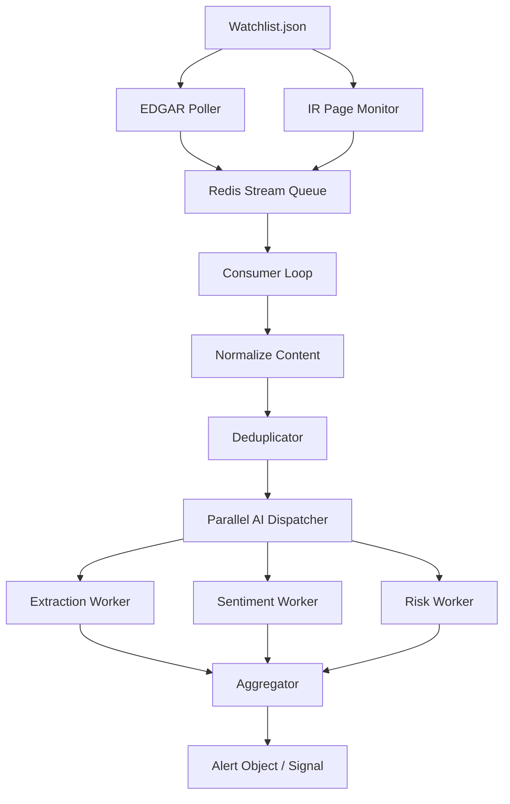

# Project Overview

## Summary

This project is a **low-latency SEC filing analyzer** designed to detect a company’s new **8-K earnings filing** as quickly as possible, retrieve the filing or related IR release, normalize the content, and run **parallel AI analysis** to extract structured financial signals.

The core idea is to win on speed by using multiple ingestion paths at once:
- **SEC EDGAR polling**
- **Company IR website monitoring**
- **Deduplication**
- **Concurrent AI workers for extraction, sentiment, and risk**

The end result is an alert object with a bullish / neutral / bearish signal and supporting evidence.

---

## Tech Stack

### Language / Runtime
- **Python 3.14+**
- Async-first architecture using `asyncio`
- `uv` as the package manager

### Networking / Ingestion
- `httpx` for async HTTP requests
- `aiohttp` listed in dependencies, though the visible code mainly uses `httpx`
- `feedparser` for RSS-style sources
- `beautifulsoup4` for HTML parsing

### Document Processing
- `PyMuPDF (fitz)` for PDF text extraction
- HTML normalization via BeautifulSoup

### AI / Structured Output
- Worker-based prompt system
- `workers.client.invoke()` appears to call an LLM or external AI service
- JSON-shaped outputs for extraction, sentiment, and risk analysis

### Queue / State
- `redis.asyncio` for the filing stream
- Redis Streams used as the message transport

### Configuration / Utilities
- `python-dotenv`
- Centralized logging in `utils.logger`
- Watchlist-driven runtime configuration via `watchlist.json`

### Testing
- `pytest`-style tests visible in `tests/`

---

## High-Level Architecture

---

## User Flow

### 1. Watch companies
The system reads `watchlist.json`, which contains company metadata such as:
- `ticker`
- `cik`
- optional IR page URL and selector

### 2. Detect a new filing fast
There are two parallel detection paths:

#### A. SEC EDGAR poller
- Fetches the company’s latest accession number from the SEC submissions API
- Predicts the next accession number
- Builds the expected filing index URL
- Polls the SEC index page every second until the filing appears

#### B. IR website monitor
- Polls the company’s investor relations page every 5 seconds
- Detects new press releases before or around SEC posting time
- Hashes links to avoid repeated detection

### 3. Push filing metadata into Redis
Detected filings are enqueued into a Redis Stream named `filings`.

### 4. Consume and normalize
The consumer loop:
- reads from the queue
- fetches raw text if available
- normalizes HTML or PDF into plain text

### 5. Deduplicate
A SHA-256 hash of the first portion of the filing is used to skip duplicates.

### 6. Run AI workers in parallel
The normalized filing is sent to three workers concurrently:
- **Extraction**
- **Sentiment**
- **Risk**

### 7. Aggregate output
The results are combined into an alert with:
- signal score
- signal label
- EPS summary
- revenue summary
- guidance direction
- risk flags
- tone

---

## Core Components

### `main.py`
Main orchestration entrypoint.
- Starts the watcher
- Starts the consumer loop
- Coordinates the full ingestion-to-alert pipeline

### `ingestion/edgar_poller.py`
SEC-first detection logic.
- Gets latest accession number from SEC submissions API
- Predicts next accession
- Polls for filing availability
- Fetches the actual filing document

### `ingestion/ir_monitor.py`
Secondary detection channel.
- Watches company IR press release pages
- Detects new release links
- Enqueues the event into Redis

### `ingestion/deduplicator.py`
Simple duplicate prevention.
- SHA-256 hash of the first 2000 characters
- Prevents repeated processing of the same filing content

### `pipeline/queue.py`
Redis Stream wrapper.
- `enqueue()`
- `consume()`
- `ack()`

### `pipeline/normalizer.py`
Content cleanup and extraction.
- HTML cleanup via BeautifulSoup
- PDF text extraction via PyMuPDF

### `pipeline/dispatcher.py`
Concurrent AI execution.
- Runs all workers via `asyncio.gather()`
- Returns a merged result dict

### `workers/extraction_worker.py`
Extracts structured financial data such as:
- EPS actual / estimate
- revenue actual / estimate
- beat / miss
- gross margin
- net income
- guidance
- fiscal period
- report date

### `workers/sentiment_worker.py`
Infers tone and messaging style:
- bullish / neutral / cautious / bearish
- guidance tone
- YoY trend
- headline signal
- notable quotes

### `workers/risk_worker.py`
Identifies material risk signals:
- guidance cuts
- layoffs
- restatements
- legal issues
- macro headwinds
- customer concentration
- debt
- going concern warnings

### `aggregator/aggregator.py`
Computes the final signal.
- Starts from neutral score
- Adjusts based on:
  - EPS beat/miss
  - revenue beat/miss
  - guidance changes
  - sentiment
  - risk flags
- Produces a final alert object

---

## Parallel Workflow

A key design goal is speed. The system is structured so multiple slow operations happen at the same time:

1. **SEC polling** and **IR monitoring** run concurrently
2. Multiple companies are watched in parallel
3. Once a filing is detected, the AI analysis stage runs in parallel
4. The three workers complete independently, and the aggregator merges the output

This keeps latency low and prevents the overall pipeline from waiting on one analysis step before starting another.

---

## Data Flow

1. **Company identified in watchlist**
2. **New filing detected**
3. **Filing metadata enqueued in Redis**
4. **Consumer reads event**
5. **Document normalized**
6. **Duplicate check**
7. **Parallel AI analysis**
8. **Signal scoring**
9. **Alert generated**

---

## Notable Design Characteristics

- **Async-first** for speed and concurrency
- **Redis Streams** for decoupled ingestion and processing
- **Multiple source detection** to reduce delay
- **AI workers isolated by task** for modular prompts
- **Structured JSON output** for easy downstream use
- **Signal scoring layer** to convert raw analysis into a trading-style alert

---

## Practical Purpose

The project is built to help detect whether an 8-K filing or earnings release is likely:
- bullish
- neutral
- bearish

It does this by combining:
- financial extraction
- management tone
- risk language
- guidance changes

into a single low-latency alert pipeline.
