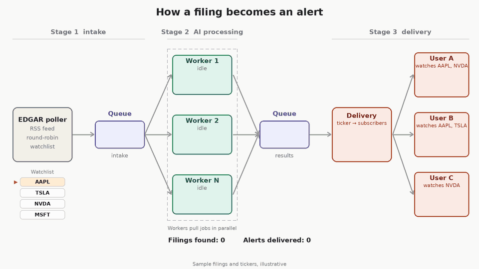

# beatingTheSEC

Low-latency SEC 8-K earnings filing analyzer. Detects new filings as fast as possible, runs parallel AI analysis, and fans out structured alerts to subscribers via Discord.



---

## What it does

1. Watches a list of companies for new 8-K filings via a shared, budget-capped rotation scheduler (see `docs/checklist.md`)
2. Fetches the press release (EX-99.1 exhibit), normalizes it to plain text
3. Runs three AI workers in parallel: financial extraction, sentiment, risk
4. Scores the result (bullish / neutral / bearish) and sends a Discord alert to every subscriber of that ticker

Detection-to-alert latency depends on watchlist size vs. `DETECTION_BUDGET` (see `config.py`) —
not a fixed number. See `docs/checklist.md` for the current rotation-scheduler design and its
known gaps (no calendar-based hot-set gating yet, no secondary confirmation poller).

---

## Architecture

```
watchlist.json + data/users.json
        │
        ▼
┌───────────────────────────────────┐
│   ingestion/watcher.py            │
│   run_watcher()                   │
│   ┌──────────────────────────┐    │
│   │ rotation_scheduler.py    │    │  single budget-capped loop, shared across the
│   │  run_rotation()          │    │  whole hot set — NOT one task per company
│   └──────────┬───────────────┘    │
└──────────────┼────────────────────┘
               │ DetectorResult
               ▼
        pipeline/queue.py          InMemoryFilingQueue (dev) or KafkaFilingQueue (prod)
               │
               ▼
        pipeline/normalizer.py     HTML/PDF → clean text → split sections
               │
               ▼
        ingestion/deduplicator.py  SHA-256 hash check — skip if seen
               │
               ▼
        pipeline/dispatcher.py     asyncio.gather → 3 AI workers in parallel
          ┌────┴─────┬──────────┐
          ▼          ▼          ▼
     extraction  sentiment   risk
          └────┬─────┘──────────┘
               ▼
        aggregator/aggregator.py   signal score (0.0–1.0) → label + alert dict
               │
               ▼
        delivery/router.py         SubscriptionRouter → fan-out to per-user Discord webhooks
```

`ingestion/edgar_poller.py`'s `poll_for_filing` and `ingestion/watcher.py`'s original
`watch_company`/`_detect_filing` per-company race are kept in the codebase (used by
`tests/test_e2e_rss_detection.py` and as a reference implementation) but are **not** what
`run_watcher` uses in production anymore.

---

## Running the app

```bash
# Install dependencies
uv sync

# Fill in credentials in .env (GEMINI_API_KEY required; CONFLUENT_* only for --stage runs)

# Dev mode — single process, in-memory queue, no Kafka needed
python main.py

# Production — three independent stages (requires Confluent Cloud)
python main.py --stage ingestion   # terminal 1: detect filings → Kafka
python main.py --stage ai-worker   # terminal 2: AI analysis → Kafka
python main.py --stage delivery    # terminal 3: fan-out → Discord
```

---

## Configuration files

| File | Purpose |
|---|---|
| `.env` | API keys and Confluent credentials (never commit) |
| `watchlist.json` | Company registry — ticker + CIK for every company the system can watch |
| `data/users.json` | Per-user config — which tickers they watch + their Discord webhook URL (never commit) |
| `config.py` | Shared constants: age limits, cooldown, detection budget, Kafka topic names, concurrency |

---

## Key design decisions

- **Detection is a shared, budget-capped rotation, not one task per company** — SEC's fair-access guideline caps automated polling at ~10 req/sec total; `ingestion/rotation_scheduler.py` cycles the whole hot set through a fixed per-second budget (`DETECTION_BUDGET` in `config.py`) instead of racing an independent detector per company. See `docs/checklist.md` for the full design rationale and known gaps.
- **A detected company is dropped from rotation, not requeued** — frees its slot immediately, shrinking worst-case latency for the rest of the hot set as a cluster of same-day filings drains.
- **`CooldownAwareHotSet` prevents immediate re-polling** — a company that just fired won't resync back into rotation until `POST_FILING_COOLDOWN_HOURS` has passed.
- **No calendar-based hot-set gating yet** — every company in `watchlist.json` is currently treated as always "hot." This is the biggest open gap: it means detection latency scales with total watchlist size, not with how many companies are actually near an earnings date.
- **No secondary confirmation poller currently wired in** — `ingestion/backstop_poller.py` exists but is deliberately not called from `run_watcher`; its accession-number-prediction approach proved unreliable across companies using different filing agents.
- **Age filter is per-poll, not at startup** — filings older than `MAX_FILING_AGE_HOURS` are skipped each poll cycle. Configurable so testing with recent-but-not-fresh filings still works.
- **AI workers run in parallel** — `asyncio.gather` over extraction + sentiment + risk. Total time = slowest worker, not sum.
- **Fan-out is per-ticker** — `SubscriptionRouter` looks up only the users subscribed to the detected ticker. One AI pipeline run serves all subscribers.
- **`InMemoryFilingQueue` in dev, `KafkaFilingQueue` in prod** — same `FilingQueue` protocol, swap at startup via `--stage` flag.

---

## Directory map

| Directory | What lives there |
|---|---|
| `ingestion/` | Filing detection: EDGAR poller, RSS feed, watcher orchestration, deduplicator, estimates fetch |
| `pipeline/` | Queue abstraction, normalizer, AI dispatcher, Kafka consumer/producer |
| `workers/` | AI prompt workers: extraction, sentiment, risk + Gemini client |
| `aggregator/` | Signal scoring and alert dict construction |
| `delivery/` | Discord webhook sender, per-ticker subscription router |
| `models/` | Pydantic/dataclass data models: DetectorResult, User, Company |
| `utils/` | Logger, Kafka config helper, user config loader |
| `tests/` | E2E and unit tests — see `tests/README.md` for how to run each |
| `docs/` | Planning docs, Kafka scaling write-up, multi-user checklist |
| `data/` | Sample filing HTML files used by tests |
